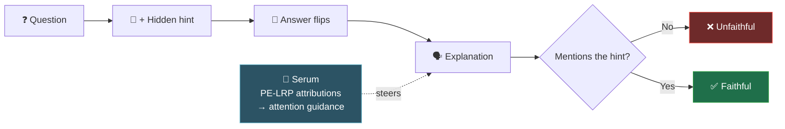

<div align="center">


<a href="https://2026.aclweb.org/"></a>

**ACL 2026 · Main Conference**

**Bar Alon · Itamar Zimerman · Lior Wolf**

<a href="https://aclanthology.org/2026.acl-long.300/"></a>
<a href="https://arxiv.org/abs/2604.14325"></a>


</div>

<br/>

> [!NOTE]
> **LLMs can give an answer and then explain it for the wrong reason.**
> This repo measures that gap and introduces a training-free way to close it.

## 💡 Key idea

We turn faithfulness into a **causal test**:

1. ❓ Ask a question
2. 🤫 Add a hidden hint that changes the answer
3. 🗣️ Ask the model to explain

If the explanation ignores the hint, it is **not faithful**.

Then we fix it: compute token attributions with **PE-LRP** and **inject them into attention** while the model writes its explanation. This forces the explanation to follow the model's actual evidence.



## 📊 At a glance

<div align="center">

| 🚀 Faithfulness gain | 📚 Benchmarks | 🧩 Hint types | 🤖 Models |
|:-:|:-:|:-:|:-:|
| **up to ~100%** | **5** | **4** | **GPT-4o · Gemini 2.0 Flash · Llama 3.1 · Qwen 2.5** |

</div>

Training-free · inference-time only · no extra models.

## 🧰 What's inside

| | |
|:-:|---|
| 🔍 | Measure explanation faithfulness with counterfactuals |
| 🧪 | Test how models respond to misleading hints |
| 🧠 | Improve explanations with attention-level interventions |
| 📊 | Evaluate results across models and datasets |

## 🗂️ Project structure

```
FaithfulSerum/
│
├── src/                        # Core library
│   ├── lxt/                    # PE-LRP implementation
│   ├── utils.py                # Prompts, parsing, attention utilities
│   └── settings.py             # Configs and templates
│
├── scripts/                    # Experiment scripts
│   ├── lrp_guidance.py         # Main pipeline (generation + intervention)
│   ├── generate_gemini.py      # Gemini generation
│   ├── generate_gpt.py         # GPT generation
│   └── eval_closed.py          # Evaluation for closed models
│
├── examples/                   # Ready-to-run shell commands
│   ├── generate.sh             # Run closed-source generation
│   ├── eval_closed.sh          # Evaluate closed-source outputs
│   └── run_intervention.sh     # Run open-source model with intervention
│
└── requirements.txt
```

## ⚙️ Setup

Requires **Python 3.9+**.

```bash
pip install -r requirements.txt
```

## 🚀 Usage

Ready-to-run examples live in [`examples/`](examples/).

<details open>
<summary><b>1️⃣ Generate (closed-source models)</b></summary>

<br/>

Add your API keys first, then:

```bash
bash examples/generate.sh
```

</details>

<details open>
<summary><b>2️⃣ Evaluate outputs</b></summary>

<br/>

```bash
bash examples/eval_closed.sh
```

Or with custom arguments:

```bash
python scripts/eval_closed.py \
    --dataset_specific_name all \
    --eval_model_path Qwen/Qwen2.5-14B-Instruct \
    --verbose \
    --eval_file_path <YOUR_GENERATION_FILE>
```

</details>

<details open>
<summary><b>3️⃣ Run with intervention (open-source models)</b></summary>

<br/>

```bash
bash examples/run_intervention.sh
```

Or with custom arguments:

```bash
python -u scripts/lrp_guidance.py \
    --dataset_specific_name all \
    --num_of_examples 2000 \
    --eval_model_path Qwen/Qwen2.5-14B-Instruct \
    --model_path meta-llama/Llama-3.1-8B-Instruct \
    --alpha 0.06 \
    --verbose \
    --dataset commonsenseqa \
    --hint_type sycophancy
```

</details>

> [!TIP]
> `alpha` controls the intervention strength. Too low → no effect. Too high → unstable or repetitive outputs. The best results sit in a narrow range.

## 🎯 Why this matters

Text explanations are widely used for transparency. If they don't reflect the real decision process, they can mislead. This work moves toward explanations you can actually **trust**.

## 📝 Citation

```bibtex
@misc{alon2026faithfulnessserummitigatingfaithfulness,
      title={Faithfulness Serum: Mitigating the Faithfulness Gap in Textual Explanations of LLM Decisions via Attribution Guidance},
      author={Bar Alon and Itamar Zimerman and Lior Wolf},
      year={2026},
      eprint={2604.14325},
      archivePrefix={arXiv},
      primaryClass={cs.CL},
      url={https://arxiv.org/abs/2604.14325},
}
```

## 💬 Contact

Questions? Open an [issue](../../issues) or reach out.


